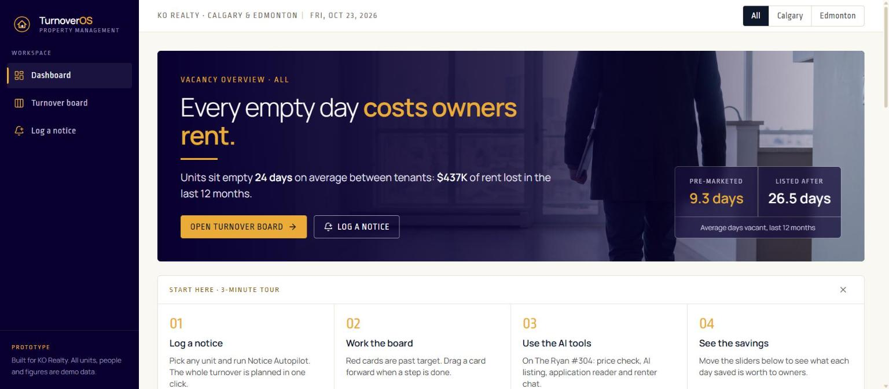
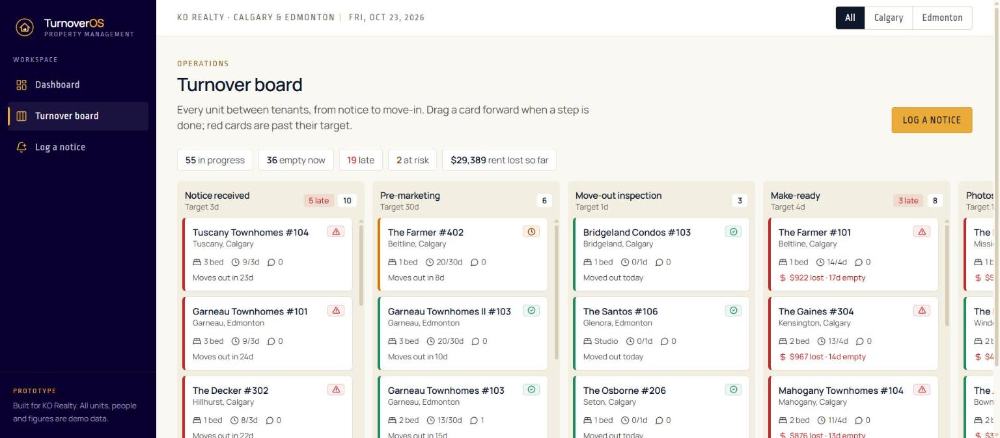
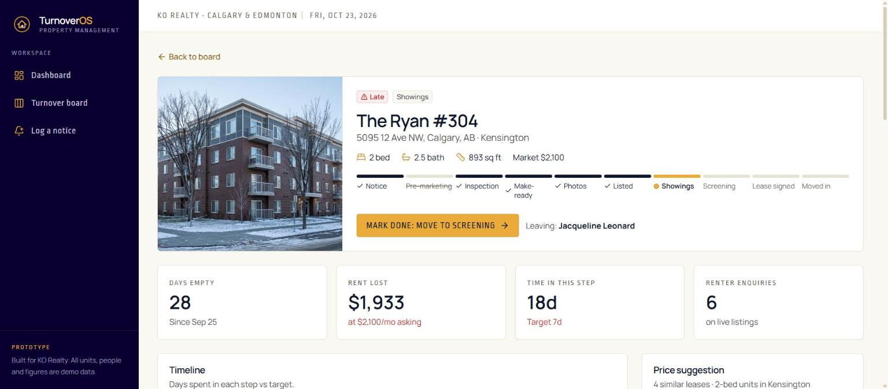

# TurnoverOS

A prototype that cuts **days vacant between tenants** for a property manager
running ~800 rental units in Calgary and Edmonton.

It tracks every unit from *"tenant gave notice"* to *"new tenant moved in"*,
shows where days are lost, and automates the slow steps.

**Live demo:** https://turn-over-os-prototype-vk8j.vercel.app

> Prototype built for KO Realty with fake demo data. See [PLAN.md](PLAN.md).

| Dashboard | Turnover board | Unit |
|---|---|---|
|  |  |  |

## AI features (Gemini)
- **Listing writer**: unit facts + photos → Rentfaster ad and Facebook post, with a fair-housing check.
- **Application reader**: PDF, photo or handwritten scan → structured fields, summary, follow-up
  questions. Income is converted in code; a person approves or declines.
- **Renter reply bot**: instant answers from listing facts, offers showing slots, hands anything
  else to a person. Ignores instructions hidden in renter messages.

Models are tried in order (`GEMINI_MODELS`, default `gemini-3.5-flash,gemini-2.5-flash`), with
retries for dropped connections and fallback when a model is busy. If every model fails, the
listing writer returns a plain template so the app never dead-ends.

## Stack
FastAPI · PostgreSQL · SQLAlchemy/Alembic · React + TypeScript + Tailwind · Gemini API

## Run locally
```bash
docker compose up -d                      # PostgreSQL on port 5433

cd backend
python -m venv .venv && .venv/Scripts/pip install -r requirements.txt
cp .env.example .env                      # add GEMINI_API_KEY
.venv/Scripts/alembic upgrade head        # create tables
.venv/Scripts/python -m app.seed          # 800 fake units + 12 months history
.venv/Scripts/uvicorn app.main:app --reload --port 8000

cd ../frontend
npm install && npm run dev                # http://localhost:5173
```

API docs: http://localhost:8000/docs

## Tests
```bash
cd backend
.venv/Scripts/pip install -r requirements-dev.txt
.venv/Scripts/python -m pytest -q         # rolled-back transaction; Gemini is mocked
```

Sample applications for the reader: `python scripts/make_samples.py` (writes to `frontend/public/samples/`).

## Deploy (free, no card)
Two Vercel projects from this repo, plus a Neon Postgres database:

| Project | Root directory | Environment variables |
|---|---|---|
| API | `backend` | `DATABASE_URL` (Neon), `GEMINI_API_KEY`, `GEMINI_MODELS` |
| Web | `frontend` | `VITE_API_URL` = the API project's URL |

The API creates its tables and loads fresh demo data on the first request of each day
(Postgres advisory lock prevents double seeding). AI endpoints are limited per visitor.
